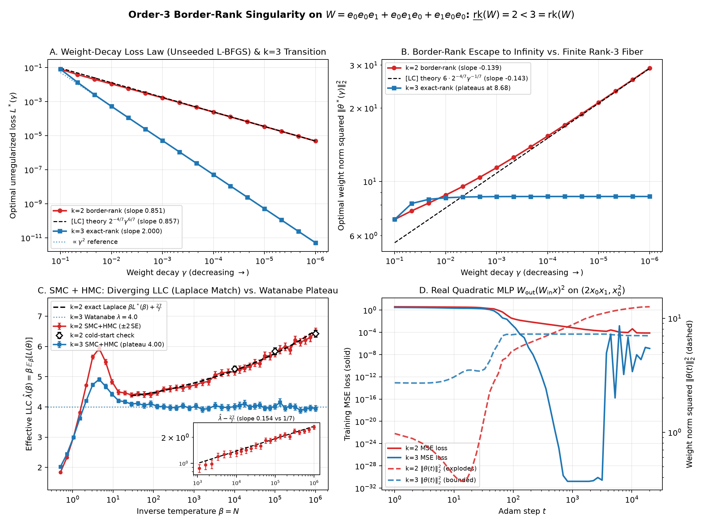

# Border Rank and Stretched-Exponential Free Energy in Bilinear MLPs

## Status of Each Claim

- **`[LC]`** (Lean 4 kernel-certified, zero `sorry`, axioms `[propext, Classical.choice, Quot.sound]` only, in `lean/EatYourFiber/BorderRankSLT.lean`):
  - **Rank bridge:** bilinear MLP ↔ OpenAI `Tensor` rank / border rank (`exists_zero_loss_iff_tensorRank_le`, `geometricBorderRank_le_of_approx_loss`).
  - **Algebraic gap:** for the canonical $W$-tensor over every field $F$, $\mathrm{geometricBorderRank}(W) = 2 < 3 = \mathrm{tensorRank}(W)$ (`wTensor_geometricBorderRank`, `wTensor_tensorRank`, `wTensor_borderRank_lt_tensorRank`).
    - Builds on OpenAI's vendored `BorderRank.lean` (`card_le_geometricBorderRank_of_minor`).
  - **Escape law:** $\inf_{\|\theta\|_2 \le R} \|T(\theta) - W\|_F^2 \asymp R^{-12}$ (`wTensor_loss_ge_of_paramNormSq`, `wTensor_escape_upper`).
    - Attained by the centered finite-difference curve $\tilde W_\varepsilon = W + \varepsilon^2 e_1^{\otimes 3}$.
    - The textbook one-sided curve $W_\varepsilon$ gives $R^{-6}$, so the centered curve gains a factor of 2 in the exponent.
  - **Weight-decay scaling:** $\inf_\theta (\|T(\theta) - W\|_F^2 + \gamma \|\theta\|_2^2) \asymp \gamma^{6/7}$ (`wTensor_weightDecay_lower`, `wTensor_weightDecay_upper`).
  - **Free energy, width 2 vs. width 3:**
    - Width 2: $c_1 N^{1/7} \le -\log Z_W^{(2)}(N) \le c_2 N^{1/7}$ (`wPartitionZ_two_le_stretchedExp`, `wPartitionZ_two_ge_stretchedExp`).
    - Width 3 (codimension 8): $-\log Z_W^{(3)}(N) \le 4 \log N + C_3$ (`wPartitionZ_three_ge_poly_sharp`). This sharpens the elementary $N^{-9}$ bound `wPartitionZ_three_ge_poly` to exponent 4, so Lean certifies $\lambda \le 4$; equality $\lambda = 4$ is `[paper]` + `[empirical]`.
- **`[empirical]`** (`experiments/bilinear_border_rank.py`, `experiments/results/bilinear_border_rank.{json,png}`):
  - Multi-start L-BFGS weight-decay scaling ($k=2$ vs. $k=3$).
  - SMC + HMC Bayesian free energy and the effective LLC $\hat\lambda(\beta) = \beta \mathbb{E}_\beta[L(\theta)]$, which diverges for $k = 2$.
  - Training dynamics of a 1-hidden-layer quadratic MLP $f(x) = W_{\mathrm{out}}(W_{\mathrm{in}} x)^{\odot 2}$.

> **See also:** [generic_border_rank.md](generic_border_rank.md) extends this measure-zero $W$-tensor class to the positive-measure open set $\operatorname{Det}(T^*) < 0$ (`[paper]` + `[empirical]`: $\gamma^{3/4}$, $\beta^{1/4}$, virial $3$), to higher-dimensional $d\times d\times d$ targets, and to real single-input Bilinear and SwiGLU MLPs.

---

## 1. Order 2 vs. Order 3

- **Order 2** (matrices / LoRA, `{BA = M*}`):
  - The locus of matrices of rank $\le k$ is Zariski-closed, so border rank equals rank.
  - A target $M^*$ is therefore either realizable at finite weights ($\lambda < \infty$, Watanabe free energy $-\log Z(N) \sim \lambda \log N$), or bounded away from zero loss ($\inf L = L^* > 0$, linear free energy $-\log Z(N) \sim N L^*$).
- **Order 3** (bilinear MLPs $T(A, B, C) = \sum_{r=1}^k a_r \otimes b_r \otimes c_r \in \mathbb{R}^{d_1 \times d_2 \times d_3}$):
  - The rank-$\le k$ locus is not closed.
  - Suppose the target lies in the border-rank gap
    $$\underline{\mathrm{rk}}(T^*) \le k < \mathrm{rk}(T^*).$$
  - Then $\inf_{\theta \in \mathbb{R}^P} L(\theta) = 0$, but the finite zero-loss fiber is empty.
  - Under a Gaussian prior (or $\ell_2$ weight decay) the posterior must move to infinity along a border-rank degeneration tube.
  - This gives a third universality class, between realizable $\Theta(\log N)$ and unrealizable $\Theta(N)$: stretched-exponential $-\log Z(N) \asymp N^{\alpha}$ with $\alpha \in (0, 1)$.

---

## 2. Theory on the $W$-Tensor (`[LC]`)

The canonical $2 \times 2 \times 2$ $W$-tensor:
$$W = e_0 \otimes e_0 \otimes e_1 + e_0 \otimes e_1 \otimes e_0 + e_1 \otimes e_0 \otimes e_0.$$

### 2.1 Algebraic Gap Over Every Field (`[LC]`)

- **`wTensor_geometricBorderRank`:** $\mathrm{geometricBorderRank}(W) = 2$.
  - **Lower bound ($\ge 2$):** OpenAI's `card_le_geometricBorderRank_of_minor` applied to the $l = 0$ flattening slice $M_0 = \begin{pmatrix} 0 & 1 \\ 1 & 0 \end{pmatrix}$ ($\det M_0 = -1 \ne 0$).
  - **Upper bound ($\le 2$):** the 1-parameter algebraic curve $W_t = t^{-1}((e_0 + t e_1)^{\otimes 3} - e_0^{\otimes 3})$ over the algebraically closed (hence infinite) field $\overline{F}$.
- **`wTensor_tensorRank`:** $\mathrm{tensorRank}(W) = 3$.
  - For any rank-2 tensor $T = a_0 \otimes b_0 \otimes c_0 + a_1 \otimes b_1 \otimes c_1$, the two $l$-slices satisfy (`rank2_slice_identities`):
    $$\det M_0 = d_{AB} c_{00} c_{01}, \qquad \det M_1 = d_{AB} c_{10} c_{11}, \qquad \operatorname{tr}(\operatorname{adj}(M_0) M_1) = d_{AB}(c_{01} c_{10} + c_{00} c_{11}),$$
    where $d_{AB} = \det A \det B$.
  - On $W$: $\det M_0 = -1$, $\det M_1 = 0$, $\operatorname{tr}(\operatorname{adj}(M_0) M_1) = 0$.
  - This forces $c_{10} = c_{11} = 0$, which contradicts $(M_1)_{00} = 1$.

### 2.2 Centered Border-Rank Curve and $R^{-12}$ Escape Law (`[LC]`)

- **One-sided curve:** $W_\varepsilon = \varepsilon^{-1}((e_0 + \varepsilon e_1)^{\otimes 3} - e_0^{\otimes 3})$ has $\|W_\varepsilon - W\|_F^2 = 3\varepsilon^2 + \varepsilon^4 \asymp R^{-6}$ (for $\|\theta\|_2 \asymp R \asymp \varepsilon^{-1/3}$).
- **Centered curve** (`centeredCurve`):
  $$\tilde W_\varepsilon = \frac{1}{2\varepsilon}\Bigl((e_0 + \varepsilon e_1)^{\otimes 3} - (e_0 - \varepsilon e_1)^{\otimes 3}\Bigr) = W + \varepsilon^2 e_1^{\otimes 3}$$
  - The $O(\varepsilon)$ error cancels.
  - Loss $L(\theta_\varepsilon) = \varepsilon^4$ and squared norm $\|\theta_\varepsilon\|_2^2 = 6(2\varepsilon)^{-2/3}(1 + \varepsilon^2)$, so
    $$L(\theta_\varepsilon) \asymp R^{-12}.$$
- **Optimality** (`wTensor_loss_ge_of_paramNormSq`): the same three 2×2 slice identities, used quantitatively, show $R^{-12}$ is optimal over all $\theta \in \mathbb{R}^{12}$:
  $$\min\!\left(\frac{1}{64},\; \frac{1}{4624\,\|\theta\|_2^{12}}\right) \le \|T(\theta) - W\|_F^2.$$

### 2.3 Weight-Decay Scaling (`γ^{6/7}`) and Free Energy (`N^{1/7}`) (`[LC]`)

Balancing $L \asymp R^{-12}$ against $\gamma R^2$ (weighted AM–GM) gives the following.

- **Regularized ERM** (`wTensor_weightDecay_lower`, `wTensor_weightDecay_upper`):
  $$\frac{1}{64}\,\gamma^{6/7} \le \inf_{\theta \in \mathbb{R}^{12}}\bigl(\|T(\theta) - W\|_F^2 + \gamma \|\theta\|_2^2\bigr) \le 13\,\gamma^{6/7} \qquad (\forall \gamma \in (0, 1]).$$
  - Leading asymptote along `centeredCurve`:
    $$J^*(\gamma) \sim 7 \cdot 2^{-4/7}\gamma^{6/7}, \qquad L^*(\gamma) \sim 2^{-4/7}\gamma^{6/7}, \qquad \|\theta^*(\gamma)\|_2^2 \sim 6 \cdot 2^{-4/7}\gamma^{-1/7}, \qquad \frac{\gamma \|\theta^*\|_2^2}{L^*} \to 6.$$
- **Bayesian partition function** $Z_W^{(k)}(N) = \int \exp\bigl(-N\|T(\theta) - W\|_F^2 - \frac{1}{2}\|\theta\|_2^2\bigr)\, d\theta$:
  - **Width $k = 2$** (`wPartitionZ_two_le_stretchedExp`, `wPartitionZ_two_ge_stretchedExp`):
    $$\left(\frac{1}{32}\right)^{12} e^{-90 N^{1/7}} \le Z_W^{(2)}(N) \le (4\pi)^6 e^{-a_1 N^{1/7}} \qquad (\forall N \ge 1,\; a_1 = 64^{-1} \cdot 4^{-6/7}).$$
    - So $-\log Z_W^{(2)}(N) \asymp N^{1/7}$.
    - The DevInterp / WBIC effective learning coefficient $\hat\lambda(N) = N \mathbb{E}_N[L(\theta)] = N \frac{d}{dN}(-\log Z_W^{(2)}(N))$ therefore diverges as $N^{1/7}$.
  - **Width $k = 3$** (`wPartitionZ_three_ge_poly`, `wPartitionZ_three_ge_poly_sharp`):
    - **Elementary $N^{-P/2}$ bound** (`wPartitionZ_three_ge_poly`): $2^{18} e^{-10404} N^{-9} \le Z_W^{(3)}(N)$ ($\forall N \ge 1$).
    - **Sharp codimension-8 bound** (`wPartitionZ_three_ge_poly_sharp`, `[LC]`):
      $$\left(\frac{1}{64}\right)^{10} \cdot 256 \cdot e^{-32807025}\, N^{-4} \le Z_W^{(3)}(N) \qquad (\forall N \ge 1).$$
      - Matches the codimension-8 regular RLCT $\lambda = 8/2 = 4.0$.
      - **Proof route:** natural-order zero-Jacobian Fubini and an explicit 10D rational fiber chart around the submersive width-3 realization $W = \frac{1}{2}(e_0+e_1)^{\otimes 3} - \frac{1}{2}(e_0-e_1)^{\otimes 3} - e_1^{\otimes 3}$.
      - **Note:** the sparse canonical decomposition `wRealize3` has a rank-7 singular Jacobian. Its missing $e_1^{\otimes 3}$ direction enters quadratically, which still gives $\lambda = 7/2 + 1/2 = 4.0$.
  - **Comparison:** adding one neuron ($k = 2 \to 3$) takes $-\log Z_W^{(k)}(N)$ from stretched-exponential $\Theta(N^{1/7})$ to Watanabe polynomial $\le 4\log N + C_3$, although both widths have $\inf L = 0$.

### 2.4 Non-Compactness and Prior Tails (`[paper]` + `[LC]`)

- **Setup:** standard SLT (Watanabe 2009, 2018) assumes a compact parameter space $\Theta \subset \mathbb{R}^P$ with compactly supported prior $\varphi(\theta)$.
- The table shows where Track 1 sits relative to that assumption.

| Prior support / tail $\pi(\theta)$ | Width $k = 2$ on $W$-tensor | Free energy $-\log Z_W^{(2)}(N)$ | Effective LLC $\hat\lambda(N) = N \mathbb{E}_N[L]$ |
| :--- | :--- | :--- | :--- |
| Compact ball $\|\theta\|_2 \le R$ | Unrealizable ($L^* \asymp R^{-12} > 0$) | $\Theta(N)$ (linear) | $\Theta(N)$ |
| Gaussian $e^{-\frac{1}{2}\|\theta\|_2^2}$ ($\ell_2$ WD) `[LC]` | Escapes along $\tilde W_\varepsilon$, $R \asymp N^{1/14}$ | $\Theta(N^{1/7})$ (stretched-exponential) | $\sim 2^{-10/7} N^{1/7} + \frac{27}{7}$ (`[paper]` Laplace) |
| Stretched-exp $e^{-c\|\theta\|_2^\alpha}$ ($\alpha > 0$) `[paper]` | Escapes with $R \asymp N^{1/(12+\alpha)}$ | $\Theta(N^{\alpha/(12+\alpha)})$ | $\Theta(N^{\alpha/(12+\alpha)})$ |
| Heavy-tailed $(1 + \|\theta\|_2^2)^{-\nu/2}$ ($\nu > P$) `[paper]` | Escapes with $R \asymp N^{1/12}$ | $\Theta(\log N)$ (prior-dependent $\lambda$) | $\Theta(1)$ (depends on $\nu$) |
| Width $k = 3$ (any positive prior) `[LC]` for $\lambda \le 4$, `[paper]` + `[empirical]` for $\lambda = 4$ | Realizable at finite $\theta^*$ | $\Theta(\log N)$ ($\lambda = 4.0$, prior-independent) | $\to 4.0$ |

- **Reading:** the stretched-exponential class $-\log Z(N) \asymp N^{1/7}$ is a non-compact SLT phenomenon. It needs both:
  - a non-closed algebraic image (border-rank gap $\underline{\mathrm{rk}}(T^*) \le k < \mathrm{rk}(T^*)$), and
  - the Gaussian prior ($\ell_2$ weight decay) standard in deep learning and Bayesian neural networks.

---

## 3. PyTorch Experiments (`[empirical]`)

Script: [bilinear_border_rank.py](../experiments/bilinear_border_rank.py) | Data: [bilinear_border_rank.json](../experiments/results/bilinear_border_rank.json) | Figure: [bilinear_border_rank.png](../experiments/results/bilinear_border_rank.png)

### 3.1 Experiment 1: Weight-Decay Scaling and Width-3 Transition (L-BFGS, $\gamma \in [10^{-6}, 10^{-1}]$)

| Quantity (fit on $\gamma \le 3\times 10^{-4}$) | `[LC]` / leading theory | Empirical ($k=2$) | Empirical ($k=3$) |
| :--- | :---: | :---: | :---: |
| Loss slope $d\log L^* / d\log\gamma$ | $6/7 = 0.8571$ ($k=2$), $2.000$ ($k=3$) | `0.8513` | `1.9996` |
| Total objective slope $d\log J^* / d\log\gamma$ | $6/7 = 0.8571$ ($k=2$) | `0.8600` | — |
| Weight norm² slope $d\log \|\theta^*\|_2^2 / d\log\gamma$ | $-1/7 = -0.1429$ ($k=2$), $0$ ($k=3$) | `-0.1386` | plateaus at `8.679` |
| Ratio $J^*(\gamma) / (7\cdot 2^{-4/7}\gamma^{6/7})$ at $\gamma=10^{-6}$ | `1.0000` | `1.0028` | — |
| Virial ratio $\gamma \|\theta^*\|_2^2 / L^*$ at $\gamma=10^{-6}$ | `6.000` | `6.05` | $1.69 \times 10^6$ |
| Residual fraction in $e_1^{\otimes 3}$ at $\gamma=10^{-6}$ | `1.0000` (centered $\tilde W_\varepsilon$) | `1.0000` | `0.4576` |

- **Random starts find the centered curve ($k=2$):**
  - **Setup:** 16 i.i.d. Gaussian starts per $\gamma$, no warm start, no analytic seeding.
  - **Result:** L-BFGS converges onto $\tilde W_\varepsilon = W + \varepsilon^2 e_1^{\otimes 3}$ in 16/16 (100%) starts at $\gamma \in \{10^{-2}, 10^{-3}, 10^{-4}\}$ (`e111 = 0.9992` at $10^{-4}$), and in 10/16 (62.5%) at $\gamma = 10^{-5}$ (`e111 = 0.9999`).
  - **Full sweep:** $\gamma \in [10^{-1}, 10^{-6}]$ uses only random starts plus warm-start continuation (no analytic seeding). It reaches `e111_residual_frac = 0.999985`, `obj/pred = 1.0028`, `virial = 6.05`.
- **Width-3 first-order branch transition:**
  - At $\gamma = 10^{-1}$ the width-3 model sits on the width-2 border-rank solution ($L = 8.066\times 10^{-2}$, $\|\theta\|_2^2 = 6.989$, matching $k=2$ to 5 significant digits).
  - **Reason:** the rank-3 realization costs more norm penalty ($\|\theta\|_2^2 \approx 8.68$).
  - Between $\gamma = 10^{-1}$ and $\gamma = 10^{-2}$, $k=3$ moves sharply onto the rank-3 fiber.

### 3.2 Experiment 2: Laplace Asymptotics and SMC + HMC ($\beta \in [0.5, 10^6]$)

#### Four-Scale Laplace Analysis for $k = 2$ (`[paper]`)

- **Setup:** Newton-refined saddle point $\theta^*(\beta)$ of $U_\beta(\theta) = \beta L(\theta) + \frac{1}{2}\|\theta\|_2^2$, with $12\times 12$ Hessian $H_U(\beta) = \beta \nabla^2 L(\theta^*) + I_{12}$.
- **Spectrum** (condition number $\kappa \approx 8.9\times 10^6$ at $\beta = 10^5$, $1.7\times 10^8$ at $\beta = 10^6$):
  - 4 torus gauge eigenvalues $= 2 = O(1)$.
  - 1 radial border-rank escape eigenvalue $\to 14 = O(1)$.
  - 3 intermediate eigenvalues $\propto \beta^{6/7}$.
  - 4 stiff eigenvalues $\propto \beta^{9/7}$.
- **Free energy:** $F_{\mathrm{Lap}}(\beta) = U_\beta(\theta^*) + \frac{1}{2}\log\det H_U(\beta) - \log 32$, where $32 = 2 \times 4^2$ counts discrete symmetry modes.
- **Result:** differentiating gives the subleading offsets
  $$\hat\lambda_{\mathrm{Lap}}(\beta) = \beta \frac{d F_{\mathrm{Lap}}}{d\beta} = \beta L^*(\beta) + \frac{27}{7} + o(1) = 2^{-10/7}\beta^{1/7} + \frac{27}{7} + o(1) \qquad \left(\frac{27}{7} = \frac{1}{2}\!\left(3\cdot\frac{6}{7} + 4\cdot\frac{9}{7}\right) \approx 3.8571\right),$$
  $$\mathbb{E}_\beta[\|\theta\|_2^2] = \|\theta^*(\beta)\|_2^2 + \frac{30}{7} + o(1) \qquad \left(\frac{30}{7} \approx 4.2857\right).$$

#### SMC + HMC and Cold-Start Checks (`[empirical]`)

- **Sampler:** 192 parallel SMC chains, 44 geometric temperatures up to $\beta = 10^6$.
  - Row-diagonal preconditioned HMC.
  - Exact torus gauge-balancing MH moves ($\det J = 1$).
  - Exact reversible 1-parameter Lie-group border-rank move $S_u = \operatorname{diag}(e^u, e^{-2u})$:
    - Leaves $W$ invariant and scales $e_1^{\otimes 3}$ by $e^{-6u}$, with Jacobian $\log|\det J| = -3ku$.
    - Removes the radial equilibration lag from $\kappa \sim 10^8$.

| $\beta$ | $k=2$ Laplace saddle $\hat\lambda$ | $k=2$ SMC+HMC $\hat\lambda$ | $k=2$ Cold-Start $\hat\lambda$ ($z$) | $k=2$ Laplace $R^2$ | $k=2$ SMC $R^2$ | $k=2$ Cold $R^2$ ($z$) |
|---:|---:|---:|---:|---:|---:|---:|
| $10^4$ | 5.208 | 5.167 ± 0.057 | 5.261 ± 0.043 ($z=1.32$) | 21.15 | 21.03 ± 0.15 | 20.64 ± 0.15 ($z=1.85$) |
| $10^5$ | 5.764 | 5.787 ± 0.062 | 5.842 ± 0.055 ($z=0.67$) | 27.51 | 27.24 ± 0.16 | 27.09 ± 0.14 ($z=0.71$) |
| $10^6$ | 6.522 | 6.467 ± 0.070 | 6.426 ± 0.058 ($z=0.46$) | 36.44 | 36.21 ± 0.16 | 36.64 ± 0.16 ($z=1.91$) |

- **Width $k = 3$ (realizable):**
  - $\hat\lambda(\beta) = \beta \mathbb{E}_\beta[L(\theta)]$ is flat at $3.999 \pm 0.061$ over $\beta \in [10^3, 10^6]$ (three decades).
  - Matches the codimension-8 regular fiber RLCT $\lambda = 8/2 = 4.0$. Cold-start checks agree within $z < 0.9$.
- **Width $k = 2$ (border rank):**
  - SMC+HMC tracks the Laplace curve $\beta L^*(\beta) + \frac{27}{7}$ across all four high-$\beta$ decades.
  - It matches independent cold-start chains within $< 2\sigma$ on both $\hat\lambda$ and $\mathbb{E}_\beta[\|\theta\|_2^2]$.
  - **LLC slope** ($\beta \ge 10^3$), excess $\hat\lambda(\beta) - \frac{27}{7}$: `+0.1535` (theory $+1/7 = +0.1429$). Raw slope `0.0447` vs. Laplace `0.0448`.
  - **Norm² slope** ($\beta \ge 10^3$), excess $\mathbb{E}_\beta[\|\theta\|_2^2] - \frac{30}{7}$: `+0.1415` (theory $+1/7 = +0.1429$).
- **Free energy and Bayes factor:**
  - $\beta = 10^5$: $F_{\mathrm{SMC}}^{(k=2)} = 60.93$ (Laplace `60.45`) vs. $F_{\mathrm{SMC}}^{(k=3)} = 52.68$. $\Delta F = 8.25$ nats, a $3.8\times 10^3\times$ Bayes factor.
  - $\beta = 10^6$: $F_{\mathrm{SMC}}^{(k=2)} = 75.06$ (Laplace `74.54`) vs. $F_{\mathrm{SMC}}^{(k=3)} = 61.85$. $\Delta F = 13.21$ nats ($e^{13.21} \approx 5.4 \times 10^5\times$ Bayes factor).
  - The preference is for the larger width-3 model over the smaller width-2 border-rank model.

### 3.3 Experiment 3: One-Hidden-Layer Quadratic MLP $f(x) = W_{\mathrm{out}}(W_{\mathrm{in}} x)^{\odot 2}$

- **Setup:** target $f^*(x) = (2 x_0 x_1,\; x_0^2)$ (the symmetric restriction of $W$), $N = 4096$ Gaussian inputs $x \sim \mathcal{N}(0, I_2)$.
- **Regularized MSE + $\gamma \|\theta\|_2^2$ sweep:**
  - $k = 2$: MSE slope `0.8489` (theory `0.8571`), norm² slope `-0.1367` (theory `-0.1429`).
  - $k = 3$: MSE slope `1.9995` (theory `2.000`).
- **Unregularized Adam (20,000 steps):**
  - $k = 3$ reaches zero loss to machine precision ($10^{-31}$ before Adam step-size jitter; $1.25 \times 10^{-7}$ at step 20k) at bounded norm² ($7.02$).
  - $k = 2$ stalls at $7.49 \times 10^{-5}$ while the weights keep growing ($\|\theta(t)\|_2^2 \to 12.61$).
