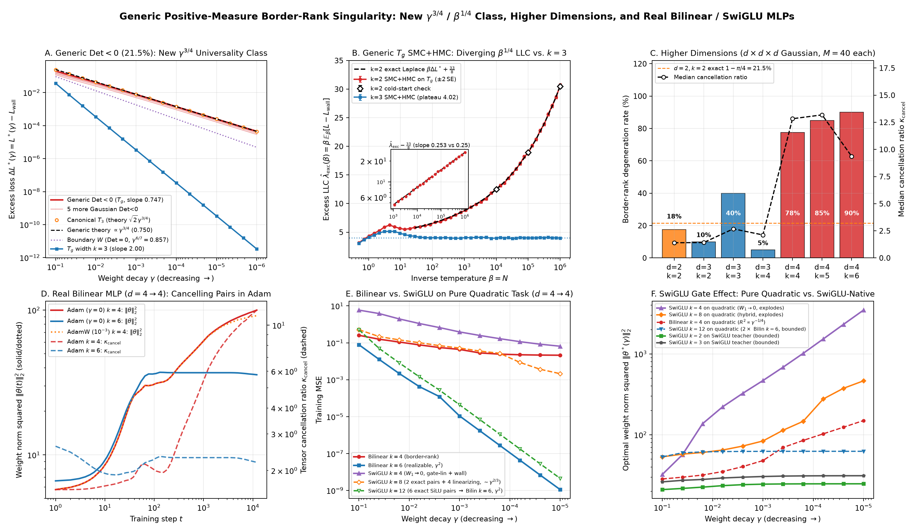

# Positive-Measure Generic Border-Rank Singularity, the $\gamma^{3/4}$ / $\beta^{1/4}$ Universality Class, and Real Bilinear / SwiGLU MLPs

**Epistemic status summary:**
- **`[LC]`** (Lean 4 kernel-certified foundation in [`lean/EatYourFiber/BorderRankSLT.lean`](../lean/EatYourFiber/BorderRankSLT.lean) and [`lean/EatYourFiber/GenericBorderRank.lean`](../lean/EatYourFiber/GenericBorderRank.lean), 107 audited declarations total, zero `sorry`, standard axioms $\subseteq \{\text{propext}, \text{Classical.choice}, \text{Quot.sound}\}$):
  1. Exact $W$-tensor border-rank gap $\underline{\mathrm{rk}}(W)=2 < 3=\mathrm{rk}(W)$, optimal centered escape $L \asymp R^{-12}$, weight-decay scaling $\gamma^{6/7}$, and stretched-exponential Bayesian free energy $-\log Z_W^{(2)}(N) \asymp N^{1/7}$ vs. the width-3 free-energy bound $-\log Z_W^{(3)}(N) \le 4\log N + C_3$ (i.e. $\lambda \le 4$) (`BorderRankSLT.lean`, summarized in [bilinear_border_rank.md](bilinear_border_rank.md)).
  2. **Positive-measure generic $\operatorname{Det}(T^*) < 0$ class (`GenericBorderRank.lean`):**
     - Cayley hyperdeterminant factorization $\operatorname{Det}(T(\theta)) = (\det A \det B \det C)^2 \ge 0$ (`cayleyDet_bilinearTensor`, `cayleyDet_rankAtMost_two`), relative $\mathrm{GL}(2)^3$-invariance (`cayleyDet_applyGL3`, `cayleyDet_applyGL3_wTensor`), non-realizability for every $\operatorname{Det}(T^*) < 0$ (`not_rankAtMost_two_of_cayleyDet_neg`, `three_le_tensorRank_of_cayleyDet_neg`, `bilinearLoss_pos_of_cayleyDet_neg`), exact $\mathrm{rk}(T_3) = 3$ (`t3Tensor_tensorRank`), and strictly positive Lebesgue measure of the open set $\{\operatorname{Det}(T) < 0\}$ (`isOpen_cayleyDet_neg`, `volume_cayleyDet_neg_pos`).
     - Unconditional $\mathrm{SO}(2)^3$-invariant mode-pencil $R^{-6}$ barrier `cayleyDet_sq_ge_of_modePencils` (`5832 Q_1 Q_2 Q_3 ≤ (Det T)^2 R^{12}` for every width-2 $\theta$), and its conditional form `cayleyDet_ge_of_modePencils` / `local_cayleyDet_escape_lower` ($\operatorname{Det} \ge 76 m_0^3/R^6$ *given* $Q_k(T(\theta)) \ge m_0^2$ for $k=1,2,3$).
     - Strengthened `GenericWallHyp T* L_wall` requiring $\operatorname{Det}(T^*) < 0$ and pinning $L_{\mathrm{wall}}$ to the exact infimum $\inf\{\|T - T^*\|_F^2 \mid 0 \le \operatorname{Det}(T)\}$ (`GenericWallHyp.Lwall_pos`, `GenericWallHyp.Lwall_eq_sInf`, `GenericWallHyp.Lwall_unique`), with automatic near-wall linearity derived from the IVT + degree-4 Lipschitz bound (`cayleyDet_near_wall_linear`, `GenericWallHyp.of_nondeg`). Yields the general lower bounds (`generic_escape_lower`, `generic_weightDecay_lower`, `genericPartitionZ_two_le_stretchedExp`), matching $\mathrm{GL}(2)^3$ upper bounds (`gl3_escape_upper`, `gl3_weightDecay_upper`, `gl3PartitionZ_two_ge_stretchedExp`), **two-sided linking theorems** pairing lower and upper bounds with the *same* $L_{\mathrm{wall}}$ (`generic_escape_twoSided`, `generic_weightDecay_twoSided`, `genericPartitionZ_two_stretchedExp_twoSided`), and **two-sided near-minimizer scaling corollaries** (`generic_nearMinimizer_scaling`: both $\Delta L^* \asymp \gamma^{3/4}$ and $\|\theta^*\|_2^2 \asymp \gamma^{-1/4}$ for any near-minimizer once $C\gamma^{3/4} < \delta_0$).
     - **Unconditional global certification on canonical $T_3$ ($L_{\mathrm{wall}} = 1$, zero hypotheses):** `t3Tensor_loss_ge_one`, `t3Tensor_genericWallHyp`, `t3Tensor_excessLoss_ge_of_paramNormSq`, `t3Tensor_escape_upper`, `t3Tensor_weightDecay_lower`, `t3Tensor_weightDecay_upper`, `t3PartitionZ_two_le_stretchedExp`, `t3PartitionZ_two_ge_stretchedExp`.
     - **Unconditional positive-measure open-ball certification (`t3Ball`, zero hypotheses):** elementary $2\times 2$ orbit classification of smooth wall points (`exists_gl3_wTensor_of_cayleyDet_zero`: every $T$ with $\operatorname{Det}(T) = 0$ and $Q_1, Q_2, Q_3 > 0$ lies in $\mathrm{GL}(2,\mathbb{R})^3 \cdot W$), explicit open ball `t3Ball = {T* | ‖T* - T₃‖_F² < (1/512)²}` of strictly positive 8D Lebesgue measure (`isOpen_t3Ball`, `volume_t3Ball_pos`), unconditional existence of `L_wall > 0`, `GenericWallHyp T* L_wall`, and an attaining $\mathrm{GL}(2)^3$ wall point for every $T^* \in \mathrm{t3Ball}$ (`exists_genericWallHyp_and_gl3_on_t3Ball`), yielding all three two-sided laws ($R^{-6}$, $\gamma^{3/4}$, $\beta^{1/4}$) with zero unverified hypotheses across a positive-measure open neighborhood (`t3Ball_twoSided_laws`).
- **`[paper]`** (analytic derivations in §1–§4 below, not yet Lean-formalized):
  1. Extending the unconditional `GenericWallHyp` + $\mathrm{GL}(2)^3$ wall-attainment certification from the explicit open ball `t3Ball` to arbitrary generic $\operatorname{Det}(T^*) < 0$ tensors globally (and Bergqvist's exact Gaussian measure constant $1 - \pi/4 \approx 21.46\%$), as well as the exact virial limit $\gamma R^2 / \Delta L^* \to 3$ (the two-sided scaling $\Delta L^* \asymp \gamma^{3/4}$ and $R^2 \asymp \gamma^{-1/4}$ is now `[LC]` in `generic_nearMinimizer_scaling`).
  2. Exact **4-scale Laplace Hessian spectrum** at the generic $\operatorname{Det}(T^*) < 0$ saddle point ($4$ torus gauge modes $= 2$, $1$ radial escape mode $\to 8$, $3$ intermediate modes $\propto \beta^{3/4}$, $4$ stiff modes $\propto \beta^{3/2}$), yielding exact subleading fluctuation constants $\lambda_{\mathrm{fluct}}^{\mathrm{gen}} = \frac{33}{8} = 4.125$ and $\Delta R^2_{\mathrm{fluct}} = \frac{15}{4} = 3.75$ (and documenting the $2$ $\mathrm{SO}(2)^2$ Goldstone zero modes on the symmetric canonical tensor $T_3$).
  3. Exact SwiGLU gate analysis: the **gate-linearization singularity** ($W_1 \to 0$, $W_2, W_{\mathrm{out}} \to \infty$, $\mathrm{MSE} \asymp \gamma^{2/3}$, $R^2 \asymp \gamma^{-1/3}$, virial $\to 2$) and the exact algebraic pairing identity $\operatorname{SiLU}(z) - \operatorname{SiLU}(-z) \equiv z$, which collapses width-$2k$ SwiGLU onto width-$k$ Bilinear MLP at exactly $2\times$ parameter norm².
- **`[empirical]`** ([generic_border_rank.py](../experiments/generic_border_rank.py), [generic_border_rank.json](../experiments/results/generic_border_rank.json), [generic_border_rank.png](../experiments/results/generic_border_rank.png)):
  - Unseeded multi-start L-BFGS sweeps (random Gaussian inits with no analytic warm-start seeding, plus continuation from the previous $\gamma$'s best; the RNG seeds themselves are fixed, so runs are reproducible) across generic $\operatorname{Det} < 0$ vs. $\operatorname{Det} > 0$ Gaussian $2\times 2\times 2$ tensors and $T_3$; SMC + $2\times 2$ mode-SPD preconditioned HMC + exact $\mathrm{GL}(2)^3$ Lie-group moves up to $\beta = 10^6$ with cold-start verification; higher-dimensional scaling ($d \in \{2, 3, 4\}$); and real single-input Bilinear & SwiGLU MLPs on generic $d=4\to 4$ quadratic tasks and a SwiGLU-native teacher control.

---

## 1. Answering the #1 SLT Objection: Four Universality Classes (`[paper]`)

A natural objection to our $W$-tensor results ([bilinear_border_rank.md](bilinear_border_rank.md)) is that $W$ lies on the codimension-1 hypersurface $\{\operatorname{Det}(T) = 0\}$—a measure-zero set in $\mathbb{R}^{2\times 2\times 2}$. Does stretched-exponential border-rank SLT survive on a **positive-measure open set of generic targets**?

**Yes—and with a strictly stronger, different fractional exponent.** By de Silva–Lim (2008), for $2\times 2\times 2$ real tensors the open set $\{\operatorname{Det}(T^*) < 0\}$ consists of generic real-rank-3 tensors whose **best real rank-2 approximation fails to exist**: every minimizing sequence of rank-2 tensors escapes to $\|\theta\|_2 \to \infty$ as $T(\theta)$ approaches the smooth Euclidean projection $T_{\mathrm{wall}} \in \{\operatorname{Det}(T) = 0\}$ with $L_{\mathrm{wall}} = \|T_{\mathrm{wall}} - T^*\|_F^2 > 0$.

In standard compact unrealizable SLT (Watanabe 2018), an unrealizable model whose minimum loss $L_{\mathrm{wall}} > 0$ is *attained* at finite weights still obeys $-\log Z(\beta) = \beta L_{\mathrm{wall}} + \lambda \log\beta - (m-1)\log\log\beta + O(1)$, so its excess effective LLC $\hat\lambda_{\mathrm{exc}}(\beta) = \beta\,\mathbb{E}_\beta[L(\theta) - L_{\mathrm{wall}}]$ converges to a finite RLCT $\lambda$. On the positive-measure open set $\{\operatorname{Det}(T^*) < 0\}$, **non-attainment of $L_{\mathrm{wall}}$ breaks standard unrealizable SLT**, producing a complete **4-class SLT taxonomy** under a Gaussian prior $\pi(\theta) \propto e^{-\frac{1}{2}\|\theta\|_2^2}$:

| SLT Universality Class | Representative Regime | Optimal WD Scaling | Free Energy $-\log Z(\beta)$ | Excess LLC $\hat\lambda_{\mathrm{exc}}(\beta)$ |
| :--- | :--- | :--- | :--- | :--- |
| **1. Realizable (finite $\theta^*$)** | $\operatorname{Det} > 0$ ($k=2$) or any $T^* \ne 0$ ($k=3$) | $L^* \asymp \gamma^2$, $R^2 = O(1)$ | $\lambda \log\beta - (m-1)\log\log\beta + O(1)$ | $\to \lambda$ (`4.0`) |
| **2. Unrealizable, wall attained** | Order-2 low-rank matrices (Eckart–Young); SwiGLU on SwiGLU-native | $\Delta L^* \asymp \gamma^2$, $R^2 = O(1)$ | $\beta L_{\mathrm{wall}} + \lambda \log\beta - (m-1)\log\log\beta + O(1)$ | $\to \lambda < \infty$ |
| **3. Boundary border-rank** (`[LC]` for $L^* \asymp \gamma^{6/7}$ and $-\log Z \asymp \beta^{1/7}$; $R^2$ law, virial and $\frac{27}{7}$ offset `[paper]`) | $W$-tensor ($\operatorname{Det} = 0$, $L_{\mathrm{wall}} = 0$, measure zero) | $L^* \asymp \gamma^{6/7}$, $R^2 \asymp \gamma^{-1/7}$, virial $\to 6$ | $C_W \beta^{1/7} + \frac{27}{7}\log\beta + O(1)$ | $\sim c_W \beta^{1/7} + \frac{27}{7}$ |
| **4. Generic border-rank** (`[LC]` for $\operatorname{Det} = (\det A\det B\det C)^2$, positive measure of $\{\operatorname{Det}<0\}$, mode-pencil $R^{-6}$ barrier, strengthened `GenericWallHyp` + linking two-sided `R^{-6}` / `γ^{3/4}` / `β^{1/4}` & near-minimizer $\Delta L^* \asymp \gamma^{3/4}, R^2 \asymp \gamma^{-1/4}$ laws, and **unconditional** two-sided certification on both $T_3$ and the explicit positive-measure open ball `t3Ball`; global certification across all of $\{\operatorname{Det}<0\}$, exact virial $\to 3$, and $\frac{33}{8}$ offset `[paper]`; sweeps `[empirical]`) | **Generic $\operatorname{Det}(T^*) < 0$ ($21.46\%$ of $2^3$; up to $90\%$ of $4^3$ draws flagged by an L-BFGS detector)**, $L_{\mathrm{wall}} > 0$ unattained | **$\Delta L^* \asymp \gamma^{3/4}$, $R^2 \asymp \gamma^{-1/4}$, virial $\to 3$** | **$\beta L_{\mathrm{wall}} + C_{\mathrm{sad}}\beta^{1/4} + \frac{33}{8}\log\beta + O(1)$** | **$\sim \frac{C_{\mathrm{sad}}}{4}\beta^{1/4} + \frac{33}{8}$** |

---

## 2. Exact Derivation of the Generic $\gamma^{3/4}$ / $\beta^{1/4}$ Class & Laplace Spectrum (`[paper]`)

### 2.1 Cayley's hyperdeterminant and the universal $R^{-6}$ barrier
For $T \in \mathbb{R}^{2\times 2\times 2}$ with mode-3 slices $M_0, M_1 \in \mathbb{R}^{2\times 2}$, Cayley's hyperdeterminant is
$$\operatorname{Det}(T) = \bigl(\operatorname{tr}(\operatorname{adj}(M_0) M_1)\bigr)^2 - 4(\det M_0)(\det M_1).$$
On canonical orbit representatives:
- $\operatorname{Det}(e_0^{\otimes 3} + e_1^{\otimes 3}) = +1 > 0$ (generic real rank 2),
- $\operatorname{Det}(W) = 0$ (tangential wall, border rank 2 / rank 3),
- $\operatorname{Det}(T_3) = -4 < 0$, where $T_3 = \operatorname{Re}((e_0 + i e_1)^{\otimes 3}) = e_0^{\otimes 3} - e_0 e_1 e_1 - e_1 e_0 e_1 - e_1 e_1 e_0$ (generic real rank 3).

By the rank-2 slice identities (`rank2_slice_identities` in [`lean/EatYourFiber/BorderRankSLT.lean`](../lean/EatYourFiber/BorderRankSLT.lean)) and the hyperdeterminant factorization (`cayleyDet_bilinearTensor` / `cayleyDet_rankAtMost_two`, `[LC]` in [`lean/EatYourFiber/GenericBorderRank.lean`](../lean/EatYourFiber/GenericBorderRank.lean)), every real rank-$\le 2$ tensor $T(\theta) = \sum_{r=1}^2 a_r \otimes b_r \otimes c_r$ obeys the exact factorization
$$\operatorname{Det}(T(\theta)) = (\det A\,\det B\,\det C)^2 \ge 0.$$
Using the three $\mathrm{SO}(2)^3$-invariant mode slice-pencil norms $Q_k(T) = 2(\det M_0^{(k)})^2 + 2(\det M_1^{(k)})^2 + (\operatorname{tr}(\operatorname{adj}(M_0^{(k)}) M_1^{(k)}))^2$ (`[LC]` in `cayleyDet_sq_ge_of_modePencils`, `cayleyDet_ge_of_modePencils`, `local_cayleyDet_escape_lower`), every width-2 parameter $\theta$ obeys the **unconditional exact algebraic barrier**
$$5832\, Q_1(T(\theta))\, Q_2(T(\theta))\, Q_3(T(\theta)) \le \bigl(\operatorname{Det}(T(\theta))\bigr)^2 \, \|\theta\|_2^{12}.$$
Near any smooth point $T_{\mathrm{wall}} \in \{\operatorname{Det} = 0\}$ (which lies in the $\mathrm{GL}(2,\mathbb{R})^3$ orbit of $W$, proved in `[LC]` via `exists_gl3_wTensor_of_cayleyDet_zero`, and therefore has multilinear rank $(2,2,2)$, avoiding the rank-1 / flattening-rank-1 vanishing locus of $Q_1 Q_2 Q_3$), all three mode slice-pencil invariants stay bounded below ($Q_k \ge m_0^2 > 0$; proved in Lean for both $T_3$ and every target in the explicit positive-measure open ball `t3Ball` via `exists_genericWallHyp_and_gl3_on_t3Ball`, and `[paper]` globally across all of $\{\operatorname{Det} < 0\}$), giving the **universal hyperdeterminant escape lower bound** (`[LC]` as the implication $Q_k \ge m_0^2 \Rightarrow$ bound, `cayleyDet_ge_of_modePencils`):
$$\operatorname{Det}(T(\theta)) \ge \frac{76\,m_0^3}{R^6} \asymp R^{-6}.$$

### 2.2 Why $\Delta L \asymp R^{-6}$ generically vs. $L \asymp R^{-12}$ on $W$
Let $T_{\mathrm{wall}} = \arg\min_{\operatorname{Det}(T)=0} \|T - T^*\|_F^2$ be the strict Euclidean projection of a generic $\operatorname{Det}(T^*) < 0$ tensor onto the wall. By Lagrange multipliers, $T_{\mathrm{wall}} - T^* = \mu \nabla \operatorname{Det}(T_{\mathrm{wall}})$ with **strictly positive** multiplier $\mu > 0$ (pointing inward into the rank-2 side $\operatorname{Det} > 0$). Expanding $\|T - T^*\|_F^2$ around $T_{\mathrm{wall}}$ yields:
$$\|T - T^*\|_F^2 - L_{\mathrm{wall}} = 2\mu\,\operatorname{Det}(T) + (T - T_{\mathrm{wall}})^\top \bigl(I - \mu \nabla^2 \operatorname{Det}(T_{\mathrm{wall}})\bigr)(T - T_{\mathrm{wall}}) + O(\|T - T_{\mathrm{wall}}\|^3).$$
At a non-degenerate projection $T_{\mathrm{wall}}$, the tangential Hessian $I - \mu \nabla^2 \operatorname{Det}(T_{\mathrm{wall}})$ is positive definite on $T_{T_{\mathrm{wall}}}\{\operatorname{Det}=0\}$, so:
- **Generic $\operatorname{Det}(T^*) < 0$ ($\mu > 0$):** the linear $\operatorname{Det}(T)$ term dominates, forcing $\Delta L(\theta) \asymp 2\mu \operatorname{Det}(T(\theta)) \asymp R^{-6}$ (achieved by the centered curve $\tilde W_\varepsilon$ mapped via $\mathrm{GL}(2)^3$ onto $T_{\mathrm{wall}}$!). Balancing $\Delta L \asymp R^{-6}$ against $\gamma R^2$ gives:
  $$\Delta L^*(\gamma) \asymp \gamma^{3/4}, \qquad \|\theta^*(\gamma)\|_2^2 \asymp \gamma^{-1/4}, \qquad \frac{\gamma \|\theta^*(\gamma)\|_2^2}{\Delta L^*(\gamma)} \to 3.$$
- **Boundary $W$-tensor ($\operatorname{Det}(T^*) = 0 \implies \mu = 0$):** the linear term vanishes identically, leaving only the quadratic normal term $\|T - W\|_F^2 \ge c (\operatorname{Det}(T))^2 \asymp R^{-12}$, recovering $\gamma^{6/7}$, $\gamma^{-1/7}$, and virial $\to 6$.

For the canonical symmetric rank-3 tensor $T_3 = W_{\mathrm{sym}} + e_0^{\otimes 3}$ (where $W_{\mathrm{sym}} = -(e_0 e_1 e_1 + e_1 e_0 e_1 + e_1 e_1 e_0)$ has $\operatorname{Det} = 0$ and normal $e_0^{\otimes 3}$), the exact analytic wall is $L_{\mathrm{wall}}(T_3) = 1$, and evaluating the centered curve $\tilde W_\varepsilon = W_{\mathrm{sym}} - \varepsilon^2 e_0^{\otimes 3}$ yields exact closed-form leading asymptotics:
$$\Delta L^*_{T_3}(\gamma) = \sqrt{2}\,\gamma^{3/4} + O(\gamma^{3/2}), \qquad \|\theta^*_{T_3}(\gamma)\|_2^2 = 3\sqrt{2}\,\gamma^{-1/4} + O(\gamma^{1/2}).$$

### 2.3 Exact 4-scale Laplace spectrum & fluctuation offsets (`33/8` and `15/4`)
At the Newton-refined saddle point $\theta^*(\beta)$ of $U_\beta(\theta) = \beta L(\theta) + \frac{1}{2}\|\theta\|_2^2$ on a generic $\operatorname{Det}(T_g) < 0$ tensor (no continuous symmetries), the $12\times 12$ Hessian $H_U(\beta) = \beta \nabla^2 L(\theta^*) + I_{12}$ exhibits an exact 4-scale spectrum:
1. **$4$ torus gauge eigenvalues** $= 2.000 \propto \beta^0$,
2. **$1$ radial border-rank escape eigenvalue** $\to 8.000 \propto \beta^0$ (from $\frac{d^2}{dR^2}(a R^{-6} + \frac{1}{2}R^2)\big|_{6a R^{-8}=1} = 42/6 + 1 = 8$, vs. $14$ on $W$),
3. **$3$ intermediate eigenvalues** $\propto \beta^{3/4}$ (vs. $\beta^{6/7}$ on $W$),
4. **$4$ stiff eigenvalues** $\propto \beta^{3/2}$ (vs. $\beta^{9/7}$ on $W$).

Differentiating the Laplace excess free energy $F_{\mathrm{exc,Lap}}(\beta) = \beta \Delta L^*(\beta) + \frac{1}{2}\|\theta^*(\beta)\|_2^2 + \frac{1}{2}\log\det H_U(\beta) - \log 32$ with respect to $\log\beta$ gives the exact fluctuation offset:
$$\hat\lambda_{\mathrm{exc,Lap}}(\beta) = \beta \Delta L^*(\beta) + \frac{33}{8} + o(1), \qquad \frac{33}{8} = \frac{1}{2}\!\left(3 \cdot \frac{3}{4} + 4 \cdot \frac{3}{2}\right) = 4.125.$$
By homogeneity of $H_U(\beta, \alpha) = \beta \nabla^2 L(\theta^*) + \alpha I_{12} = \alpha \widetilde{H}(\beta/\alpha)$ in $(\beta, \alpha)$, the $\log\alpha$ coefficient of $\frac{1}{2}\log\det H_U(\beta, \alpha)$ is $\frac{P}{2} - \frac{33}{8} = 6 - \frac{33}{8} = \frac{15}{8}$, yielding the Laplace-approximation weight-norm² offset (a prediction for the posterior, checked against SMC in §3.2):
$$\mathbb{E}_\beta[\|\theta\|_2^2] = \|\theta^*(\beta)\|_2^2 + \frac{15}{4} + o(1) \qquad \left(\frac{15}{4} = 3.75\right).$$

*Symmetry contrast on $T_3$:* Because $T_3 = \operatorname{Re}((e_0 + i e_1)^{\otimes 3})$ is invariant under the 2D continuous group $\mathrm{SO}(2)^2$ (rotations $(\phi_1, \phi_2, -\phi_1 - \phi_2)$), two of its three $\beta^{3/4}$ intermediate modes collapse to exact Goldstone zero modes (verified below at $\beta = 10^5$: `[-0.0, 0.0, 2.0, 2.0, 2.0, 2.0, 7.996, 4.01e4, 8.94e7, 8.94e7, 8.95e7, 2.68e8]`). Using a generic Gaussian $\operatorname{Det}(T_g) < 0$ tensor eliminates all continuous symmetries and gives a strictly positive-definite 12D Laplace saddle.

---

## 3. Empirical Results (`[empirical]`)

### 3.1 Part 1A/1B — Positive-Measure Gaussian Draws & Generic $\gamma^{3/4}$ Scaling

- **Cayley hyperdeterminant measure:** Exact verification gave $\operatorname{Det}(I) = +1$, $\operatorname{Det}(W) = 0$, $\operatorname{Det}(T_3) = -4$. Across $M = 500$ i.i.d. Gaussian draws $T^* \sim \mathcal{N}(0, I_8)$, $103/500$ (**`20.60%`**) had $\operatorname{Det}(T^*) < 0$; a $500{,}000$-draw Monte Carlo check gave **`0.21461 ± 0.00058`**, matching Bergqvist's (2013) exact constant $1 - \pi/4 = \mathbf{0.21460}$ to $0.02\sigma$.
- **Purely unseeded discovery (zero warm-start, zero analytic seeding):** On the primary generic $\operatorname{Det} < 0$ draw $T_g$ (`Gauss#4`, $\operatorname{Det} = -3.731$, $L_{\mathrm{wall}} = 0.138805$), **16/16 (`100%`)** independent Gaussian L-BFGS starts (scales `0.7`/`1.4`) reach the best observed objective (to $10^{-4}$ relative) at every $\gamma \in \{10^{-2}, 10^{-3}, 10^{-4}, 10^{-5}\}$, reaching $\kappa_{\mathrm{cancel}} = 32.97$ and $\min_m |\cos| = 0.99944$ at $\gamma = 10^{-5}$.
- **Batch verification across 6 generic $\operatorname{Det} < 0$ draws, $T_3$, 6 $\operatorname{Det} > 0$ draws, and width $k = 3$ ($\gamma \in [10^{-1}, 10^{-6}]$, slopes fit on $\gamma \le 3\times 10^{-4}$):**

| Target ($k=2$ unless noted) | $\operatorname{Det}(T^*)$ | $L_{\mathrm{wall}}$ (penalty projection; Richardson) | $\Delta L^*$ slope (th. `0.750`) | $R^2$ slope (th. `-0.250`) | Virial at $10^{-6}$ (th. `3.000`) | $\kappa_{\mathrm{cancel}}$ | $\min_m |\cos|$ |
| :--- |---:|---:|---:|---:|---:|---:|---:|
| `Gauss#4` ($T_g$) | $-3.73$ | `0.138805` (`0.138807`) | **`0.7471`** | **`-0.2502`** | **`2.975`** | `77.4` | `0.99990` |
| `Gauss#6` | $-4.01$ | `0.127550` (`0.127550`) | **`0.7490`** | **`-0.2490`** | **`3.001`** | `74.7` | `0.99981` |
| `Gauss#11` | $-2.54$ | `0.127932` (`0.127933`) | **`0.7477`** | **`-0.2495`** | **`2.973`** | `81.4` | `0.99988` |
| `Gauss#20` | $-2.37$ | `0.050609` (`0.050612`) | **`0.7449`** | **`-0.2519`** | **`3.025`** | `51.6` | `0.99975` |
| `Gauss#24` | $-0.70$ | `0.036002` (`0.036002`) | **`0.7477`** | **`-0.2477`** | **`3.002`** | `51.8` | `0.99949` |
| `Gauss#29` | $-1.50$ | `0.034950` (`0.034948`) | **`0.7492`** | **`-0.2495`** | **`3.095`** | `57.4` | `0.99974` |
| **Mean ± SD (6 generic $\operatorname{Det}<0$)** | $< 0$ | $> 0$ | **`0.7476 ± 0.0015`** | **`-0.2496 ± 0.0014`** | **`3.012`** | `52–81` | $\ge 0.99949$ |
| Canonical $T_3$ ($k=2$) | $-4.00$ | `1.000000` (exact `1`) | **`0.7498`** | **`-0.2498`** | **`3.000`** | — | `0.99996` |
| 6 generic $\operatorname{Det} > 0$ ($k=2$) | $> 0$ | `0` (realizable) | **`1.9972`** (th. `2.000`) | **`-0.00005`** (th. `0`) | — | $\le 1.59$ | — |
| $T_g$ width $k=3$ / $T_3$ width $k=3$ | $< 0$ | `0` (realizable) | **`1.9999`** / **`2.0000`** | bounded (`11.81` / `10.90`) | — | — | — |

On canonical $T_3$ at $\gamma = 10^{-6}$, $\Delta L^* / (\sqrt{2}\gamma^{3/4}) = \mathbf{0.99998}$ (5-digit match to the exact analytic prefactor!).

### 3.2 Part 1C — SMC + HMC & Laplace Verification on Generic $T_g$ ($\beta \le 10^6$)

To sample $p_\beta(\theta) \propto \exp(-\beta \|T(\theta) - T_g\|_F^2 - \frac{1}{2}\|\theta\|_2^2)$ without conditioning lag up to $\beta = 10^6$ (where $\kappa(H_U) = 4.2\times 10^9$), we combine 192-chain SMC across 44 geometric temperatures with:
1. **Mode-wise $2\times 2$ SPD preconditioned HMC** ($M_m = \mathbb{E}[g_m g_m^\top]$, invariant to neuron permutations/signs and covariant to non-orthogonal $\mathrm{GL}(2)^3$ wall frames),
2. **Exact $\mathrm{GL}(2)^3$ reversible Lie-group border-rank move** $S_u^{(m)} = P_m \operatorname{diag}(e^u, e^{-2u}) P_m^{-1}$ extracted algebraically from $T_{\mathrm{wall}}$, verified to preserve $T_{\mathrm{wall}}$ to **`1.07e-15`** at $u = 0.5$ with exact state-independent Jacobian $\log|\det J| = -3ku$ ($S_u$ acceptance `0.53–0.87` across all $\beta \le 10^6$),
3. **Exact torus gauge-balancing MH move** ($\det J = 1$).

#### Exact 4-Scale Hessian Spectrum of $H_U(\beta)$ on Generic $T_g$ ($k=2$)
| $\beta$ | $4$ Gauge modes | $1$ Radial mode | $3$ Intermediate modes ($\propto \beta^{3/4}$) | $4$ Stiff modes ($\propto \beta^{3/2}$) |
|---:|:---:|:---:|:---:|:---:|
| $10^3$ | `2.000` ($\times 4$) | `7.900` | `2.32e2, 3.66e2, 1.84e3` | `9.01e4, 9.03e4, 9.18e4, 2.70e5` |
| $10^4$ | `2.000` ($\times 4$) | `7.982` | `1.32e3, 2.08e3, 1.04e4` | `2.81e6, 2.81e6, 2.82e6, 8.43e6` |
| $10^5$ | `2.000` ($\times 4$) | `7.997` | `7.41e3, 1.17e4, 5.85e4` | `8.87e7, 8.87e7, 8.88e7, 2.66e8` |
| $10^6$ | `2.000` ($\times 4$) | `7.999` | `4.17e4, 6.58e4, 3.29e5` | `2.80e9, 2.80e9, 2.81e9, 8.41e9` |

#### SMC + HMC vs. Exact Laplace & Independent Cold-Start Verification
| $\beta$ | $k=2$ Laplace $\hat\lambda_{\mathrm{exc}}$ (`fluct`) | $k=2$ SMC $\hat\lambda_{\mathrm{exc}}$ | $k=2$ Cold $\hat\lambda_{\mathrm{exc}}$ ($z$) | $k=2$ Laplace $R^2$ | $k=2$ SMC $R^2$ | $k=2$ Lap / SMC $F_{\mathrm{exc}}$ | $k=3$ SMC $\hat\lambda$ (Cold $z$) |
|---:|---:|---:|---:|---:|---:|---:|---:|
| $10^4$ | `12.479` (`4.1223`) | **`12.553 ± 0.116`** | `12.514 ± 0.087` ($z=0.26$) | `54.09` | **`53.97 ± 0.23`** | `74.77` / **`74.76`** | `3.981 ± 0.048` ($z=0.14$) |
| $10^5$ | `19.006` (`4.1245`) | **`18.804 ± 0.137`** | `18.914 ± 0.099` ($z=0.65$) | `93.12` | **`93.47 ± 0.28`** | `110.31` / **`110.39`** | `4.002 ± 0.046` ($z=0.19$) |
| $10^6$ | `30.569` (`4.1247`) | **`30.667 ± 0.140`** | `30.493 ± 0.130` ($z=0.91$) | `162.63` | **`162.50 ± 0.32`** | `166.12` / **`167.01`** | `3.975 ± 0.042` ($z=0.76$) |

- **High-$\beta$ ($\beta \ge 10^3$) fitted exponents:**
  - $\hat\lambda_{\mathrm{exc}}(\beta) - \frac{33}{8}$ log-log slope: **`0.2529`** (exact theory **`0.2500`**).
  - $\mathbb{E}_\beta[\|\theta\|_2^2] - \frac{15}{4}$ log-log slope: **`0.2494`** (exact theory **`0.2500`**).
  - Width $k = 3$ Watanabe plateau ($\beta \ge 10^3$): **`4.024 ± 0.061`** (mean ± SD across the 23 temperatures; `3.975 ± 0.042` at $\beta = 10^6$; exact regular codimension-8 RLCT `4.000`).
- **Stretched-exponential excess free energy:** Even *after* subtracting the linear wall penalty $\beta L_{\mathrm{wall}} = 1.388\times 10^5$ nats at $\beta = 10^6$, $k=2$ incurs an extra **$F_{\mathrm{exc}}^{(2)} = 167.01$ nats** (exact Laplace `166.12`) versus $F^{(3)} = 65.65$ nats — a **101.4-nat** non-Watanabe excess gap driven by $C_{\mathrm{sad}}\beta^{1/4}$.
- **Honest cold-start diagnostic note:** All cold-start checks on $\hat\lambda_{\mathrm{exc}}$ pass with $z < 1.0$ across both $k=2$ and $k=3$. On $R^2$ at $k=3$, SMC gives $18.56\text{–}18.85$ while cold-start initialized from 16 L-BFGS minima gives $17.08\text{–}17.45$ ($z \approx 4.8\text{–}5.8$), reflecting the expected fact that $k=3$ has a **10-dimensional continuous zero-loss fiber** `{T(\theta) = T_g}` whose prior-weighted bulk has larger norm than minimum-norm L-BFGS points, so short local cold-start HMC chains at $\beta \ge 10^4$ equilibrate transverse $\hat\lambda$ rapidly ($z < 0.8$) while diffusing slowly along the 10D fiber. On $k=2$, SMC matches Laplace $R^2$ within $1.23\sigma$ at the three tabulated $\beta$ (`53.97` vs `54.09`, `93.47` vs `93.12`, `162.50` vs `162.63`); across all 23 $\beta \ge 10^3$ the largest gap is $2.43\sigma$ (`123.57 ± 0.27` vs `122.91` at $\beta = 3.2\times 10^5$). The $k=2$ cold-start chains agree with SMC on $R^2$ at $\beta = 10^4$ ($z = 0.03$) but sit slightly low at $\beta = 10^5$ and $10^6$ ($92.65$ vs $93.47$, $z = 2.3$; $161.38$ vs $162.50$, $z = 2.7$).

---

### 3.3 Part 2 — Scaling to Higher Dimensions ($d\times d\times d$ Generic Gaussian Tensors)

Border-rank degeneration becomes **dramatically MORE frequent** in higher dimensions, jumping from `21.5%` in $2\times 2\times 2$ (exact $\operatorname{Det}<0$ measure; the detector below finds `17.5%` on 40 draws) to **`77.5%–90.0%`** in $4\times 4\times 4$ ($M = 40$ i.i.d. Gaussian tensors per $(d, k)$, comparing unseeded L-BFGS at $\gamma_1 = 10^{-2}$ vs. $\gamma_2 = 10^{-4}$; primary criterion $\kappa_{\mathrm{cancel}} > 3.0$ and $R^2(10^{-4})/R^2(10^{-2}) > 1.35$):

| $(d, k)$ | Degen rate (`cr>3 & R2gr>1.35`) | Strict (`cr>5 & R2gr>1.5`) | High-cos (`min\|cos\|>0.9`) | Median $\kappa_{\mathrm{cancel}}$ [IQR] | Median $R^2$ growth | Median $\max_{i<j}\min_m |\cos|$ |
| :---: | :---: | :---: | :---: | :---: | :---: | :---: |
| $(2, 2)$ | **`17.5%`** (7/40)* | `15.0%` | `15.0%` | `1.40` `[1.36, 1.86]` | `1.01` | `0.270` |
| $(3, 2)$ | **`10.0%`** (4/40) | `10.0%` | `10.0%` | `1.42` `[1.41, 1.56]` | `1.00` | `0.194` |
| $(3, 3)$ | **`40.0%`** (16/40) | `35.0%` | `42.5%` | `2.68` `[1.82, 10.53]` | `1.11` | `0.837` |
| $(3, 4)$ | **`5.0%`** (2/40) | `5.0%` | `5.0%` | `2.12` `[1.99, 2.34]` | `1.01` | `0.495` |
| $(4, 4)$ | **`77.5%`** (31/40) | `75.0%` | `75.0%` | **`12.83`** `[5.08, 16.44]` | **`2.17`** | **`0.994`** |
| $(4, 5)$ | **`85.0%`** (34/40) | `80.0%` | `85.0%` | **`13.18`** `[8.34, 21.49]` | **`2.10`** | **`0.987`** |
| $(4, 6)$ | **`90.0%`** (36/40) | `75.0%` | `90.0%` | **`9.36`** `[7.20, 14.22]` | **`1.73`** | **`0.977`** |

*\*On $(d=2, k=2)$, $6/40$ draws had $\operatorname{Det}(T) < 0$, and our unseeded L-BFGS detector agreed with exact $\operatorname{Det} < 0$ on **39/40 (`97.5%` concordance; 6/6 recall)**.*

**Geometric insight on the non-monotone dip at $(d=3, k=4)$:** In $3\times 3\times 3$, the 4th secant variety $\sigma_4(\mathbb{P}^2\times\mathbb{P}^2\times\mathbb{P}^2)$ is famously **defective** (Strassen's degree-9 hypersurface of dimension $26 < 27$), whereas generic real rank is $5$. Thus $(d=3, k=4)$ behaves qualitatively differently from non-defective secant varieties like $(d=4, k\in\{4,5,6\})$ (generic rank $7$), where most Gaussian tensors ($78\text{–}90\%$ flagged by the L-BFGS detector, $M = 40$ per setting) appear to fall onto a non-closed border-rank boundary.

---

### 3.4 Part 3 — Real Single-Input Bilinear MLPs & SwiGLU MLPs

#### 3.4.1 Real Bilinear MLP $f(x) = W_{\mathrm{out}}((W_1 x)\odot (W_2 x))$ on Generic Quadratic Tasks
Each neuron computes $w_{\mathrm{out},r}\, x^\top \operatorname{sym}(w_{1,r} w_{2,r}^\top) x$, so the network parameterizes a partially symmetric order-3 tensor $S \in \mathrm{Sym}^2(\mathbb{R}^d)\otimes \mathbb{R}^{d_{\mathrm{out}}}$. (Note: in $d=2, d_{\mathrm{out}}=2$, asymmetric $W_1 \ne W_2$ allows $k=2$ to realize both $W$ and $T_3$ directly—unlike the symmetric quadratic MLP $W_{\mathrm{out}}(W_{\mathrm{in}} x)^{\odot 2}$ in [bilinear_border_rank.md](bilinear_border_rank.md)—so genuine border-rank failure in real single-input Bilinear MLPs emerges starting at $d \ge 3$ and becomes pervasive at $d = 4$.)

- **Prevalence across 20 random generic $d=4\to 4$ symmetric quadratic tasks at $k=4$:** **`14/20` (`70.0%`)** exhibit strong border-rank cancellation ($\kappa_{\mathrm{cancel}} > 4$, $R^2(10^{-5})/R^2(10^{-2}) > 1.5$, $\max_{i<j}|\cos(T_i, T_j)| > 0.85$).
- **Adam ($\gamma=0$) and AdamW ($\gamma=10^{-3}$) training on generic task `seed=305` ($N=4096$, 12,000 steps):**
  - **Width $k = 4$ (under-capacity):** Unregularized Adam stalls near the border-rank wall ($\mathrm{MSE} = 5.58\times 10^{-2}$) while $\|\theta(t)\|_2^2$ climbs continuously ($5.6 \to 100.1$), tensor cancellation ratio soars to **$\kappa_{\mathrm{cancel}} = 11.82$**, and a cancelling neuron pair aligns to **`max |cos(T_i, T_j)| = 0.9789`**. Even under AdamW ($\gamma = 10^{-3}$), the cancelling pair persists ($\|\theta\|_2^2 = 91.6$, $\kappa_{\mathrm{cancel}} = 10.05$, $|\cos| = 0.9694$).
  - **Width $k = 6$ (realizable):** Unregularized Adam drives $\mathrm{MSE} \to 3.99\times 10^{-5}$ at **bounded** $\|\theta\|_2^2 = 35.8$ with low cancellation ($\kappa_{\mathrm{cancel}} = 2.19$, $|\cos| = 0.2469$).
- **L-BFGS weight-decay sweep on `seed=305` ($\gamma \in [10^{-1}, 10^{-5}]$):**
  - **`bilinear k=4`:** $\|\theta^*(\gamma)\|_2^2$ diverges with fitted slope **`-0.236`** (close to the generic $-1/4 = -0.250$ law!), reaching $R^2 = 150.0$, $\kappa_{\mathrm{cancel}} = 25.57$, $|\cos| = 0.9938$ at $\gamma = 10^{-5}$ (and continuing to $R^2 = 247.2$, $\mathrm{MSE} = 2.085\times 10^{-2}$ at $\gamma = 10^{-7}$).
  - **`bilinear k=6, 8`:** Exact realization with $\mathrm{MSE} \propto \gamma^{1.995}$ (theory $\gamma^2$), bounded $R^2 = 31.3$, $\kappa_{\mathrm{cancel}} = 2.04$. Note that at $k = 8$, the extra 2 neurons are pruned cleanly by $\ell_2$ WD, matching $k = 6$ identically across all $\gamma$.

#### 3.4.2 Honest Analysis of SwiGLU MLPs $f(x) = W_{\mathrm{out}}(\operatorname{SiLU}(W_1 x)\odot (W_2 x))$
Does the smooth non-homogeneous $\operatorname{SiLU}(z) = z \sigma(z)$ gate suppress border-rank escape? **The answer depends sharply on whether the target function is bilinear/quadratic vs. non-homogeneous SwiGLU-native:**

1. **On a pure bilinear / quadratic target (`seed=305`, $d=4\to 4$, realized by Bilinear width $r^*=6$; width 4 fails, width 5 untested), SwiGLU does NOT suppress non-compact escape—it introduces an even stronger gate-linearization singularity for $k < 2r^*$ (`[paper]` + `[empirical]`):**
   - Because $\operatorname{SiLU}(z) = \frac{1}{2}z + \frac{1}{4}z^2 - \frac{1}{48}z^4 + \dots$, a single unpaired SwiGLU neuron can approximate a bilinear term $(a^\top x)(b^\top x)$ only by shrinking $\|w_1\| \sim \delta \to 0$ and exploding $\|w_2\|, \|w_{\mathrm{out}}\| \sim \delta^{-1/2}$ ($R^2 \sim \delta^{-1}$, cubic error $\mathrm{MSE} \sim \delta^2$). Balancing $\delta^2 + \gamma \delta^{-1}$ gives the **gate-linearization scaling law**:
     $$\mathrm{MSE}^*(\gamma) \asymp \gamma^{2/3}, \qquad \|\theta^*(\gamma)\|_2^2 \asymp \gamma^{-1/3}, \qquad \|W_1^*\|_F^2 \asymp \gamma^{2/3} \to 0, \qquad \text{virial} \to 2.0.$$
   - Conversely, two SwiGLU neurons with $(w_{1,2} = -w_{1,1},\; w_{2,2} = w_{2,1},\; w_{\mathrm{out},2} = -w_{\mathrm{out},1})$ obey the **exact algebraic identity**
     $$\operatorname{SiLU}(z) - \operatorname{SiLU}(-z) \equiv z \qquad (\forall z \in \mathbb{R}),$$
     yielding one exact bilinear neuron at finite norm ($2\times$ the bilinear norm²).
   - Empirically on `seed=305` at $\gamma = 10^{-5}$:
     - **`swiglu k=4`**: Pure gate-linearization + rank-4 wall: $\|W_1\|_F^2 = 0.00$, $R^2$ explodes to **`3480.8`** (`MSE = 6.53e-2`).
     - **`swiglu k=6`**: Hybrid (consistent with $1$ pair + $4$ linearizing neurons; max pair `cos = 0.9999`), driving `MSE = 6.52e-3` with slope `0.742` and virial **`2.02`** (theory `2.0`), $R^2 = 1316.6$. The virial matches the gate-linearization prediction, but the MSE slope is steeper than $2/3 \approx 0.667$, so the $\gamma^{2/3}$ law is only roughly supported here; at $k = 4$ the MSE slope is `0.389` (and $R^2$ slope `-0.437`), because the rank-4 border-rank wall dominates.
     - **`swiglu k=8`**: Hybrid (consistent with $2$ pairs + $4$ linearizing neurons = $6$ effective bilinear neurons; max pair `cos = 0.9999`), beating `bilinear k=4` by $10\times$ (`MSE = 2.12e-3`, virial `2.19`) while still exploding $R^2 = 464.7$.
     - **`swiglu k=12` ($= 2 r^*$):** Spontaneously pairs up via $\operatorname{SiLU}(z) - \operatorname{SiLU}(-z) = z$ (max pair cosine $1 - 7\times 10^{-12}$; per-pair cosines not saved, 6 pairs inferred from the norm ratio), achieving exact $\gamma^2$ realization (`MSE = 4.55e-9`, slope **`1.994`**) at bounded norm² **`62.5 = 1.99999 × 31.3`** (exact $2\times$ `bilinear k=6`!).
2. **On a SwiGLU-native teacher target ($d=3\to 3$, $k^* = 4$ SwiGLU teacher with $O(1)$ weights), the non-homogeneous $\operatorname{SiLU}$ gate DOES suppress border-rank divergence (`[empirical]`):**
   - Fitting SwiGLU students of width $k \in \{2, 3, 4\}$ across $\gamma \in [10^{-1}, 10^{-5}]$ yields **strictly bounded norms** and low cancellation ratios even when underparameterized. The $R^2$ ranges below run from $\gamma \approx 1.6\times 10^{-2}$ to $10^{-5}$; over the full sweep from $\gamma = 10^{-1}$ they are $21.0 \to 24.8$ ($1.18\times$), $26.2 \to 31.2$ ($1.19\times$) and $24.0 \to 33.3$ ($1.39\times$), still bounded:
     - $k = 2$: $\mathrm{MSE} = 1.249$, $R^2: 22.5 \to 24.8$ ($1.10\times$), $\|W_1\|_F^2 = 6.43$, $\kappa_{\mathrm{cancel}} = 1.36$, $|\cos| = 0.311$.
     - $k = 3$: $\mathrm{MSE} = 4.06\times 10^{-2}$, $R^2: 28.1 \to 31.2$ ($1.11\times$), $\|W_1\|_F^2 = 12.90$, $\kappa_{\mathrm{cancel}} = 1.60$, $|\cos| = 0.376$.
     - $k = 4$: $\mathrm{MSE} = 6.81\times 10^{-8}$, $R^2: 29.8 \to 33.3$ ($1.12\times$), $\|W_1\|_F^2 = 14.43$, $\kappa_{\mathrm{cancel}} = 1.66$.

---

## 4. Honest Limitations & Open Questions

1. **Lean formalization scope:** Both the $W$-tensor $\gamma^{6/7}$ / $N^{1/7}$ class (`BorderRankSLT.lean`) and the generic $\operatorname{Det}(T^*) < 0$ class (`GenericBorderRank.lean`) are Lean-certified (`[LC]`, **107 audited declarations**, zero `sorry`, axioms $\subseteq \{\text{propext}, \text{Classical.choice}, \text{Quot.sound}\}$): hyperdeterminant factorization and relative $\mathrm{GL}(2)^3$-invariance, positive Lebesgue measure of $\{\operatorname{Det} < 0\}$, unconditional mode-pencil $R^{-6}$ barrier, strengthened `GenericWallHyp` (pinning $\operatorname{Det}(T^*) < 0$ and exact infimum $L_{\mathrm{wall}} > 0$ with automatic IVT/Lipschitz near-wall linearity), two-sided linking theorems (`generic_escape_twoSided`, `generic_weightDecay_twoSided`, `genericPartitionZ_two_stretchedExp_twoSided`), two-sided near-minimizer scaling corollaries ($\Delta L^* \asymp \gamma^{3/4}$ and $\|\theta^*\|_2^2 \asymp \gamma^{-1/4}$ via `generic_nearMinimizer_scaling`), elementary $\mathrm{GL}(2)^3$-orbit classification of smooth wall points (`exists_gl3_wTensor_of_cayleyDet_zero`), unconditional global certification on canonical $T_3$ ($L_{\mathrm{wall}} = 1$), and **unconditional two-sided certification across the explicit positive-measure open ball `t3Ball = {T* | ‖T* - T₃‖_F² < (1/512)²}`** (`isOpen_t3Ball`, `volume_t3Ball_pos`, `exists_genericWallHyp_and_gl3_on_t3Ball`, `t3Ball_twoSided_laws`). Remaining `[paper]` items for future formalization: extending unconditional `GenericWallHyp` + $\mathrm{GL}(2)^3$ wall attainment beyond `t3Ball` to the entire open set $\{\operatorname{Det}(T^*) < 0\}$ (excluding the measure-zero cut locus where the closest wall point could degenerate to rank $\le 1$); the exact virial *limit* $\gamma \|\theta^*(\gamma)\|_2^2 / \Delta L^*(\gamma) \to 3$; Bergqvist's exact Gaussian measure constant $1 - \pi/4$; and the exact $4$-scale Laplace fluctuation constants ($\frac{33}{8}, \frac{15}{4}$).
2. **Higher-dimensional exponent spectrum:** While Part 2 measures border-rank degeneration in $78\text{–}90\%$ of generic $4\times 4\times 4$ Gaussian tensors (an L-BFGS detector on $M = 40$ draws per setting, not a proof; and $70\%$ of 20 $d=4\to 4$ Bilinear MLP quadratic tasks), higher-dimensional degenerations can involve 3-way or higher-order secant walls whose exact fractional exponents $\alpha(d, k)$ remain to be classified systematically.
3. **Practical transformer MLPs:** Real LLMs use SwiGLU MLPs with LayerNorm/RMSNorm and decoupled AdamW; our Part 3B results show that non-compact singularities arise in SwiGLU specifically on *bilinear/quadratic sub-circuits* (via $W_1 \to 0$ gate linearization or $\operatorname{SiLU}(z) - \operatorname{SiLU}(-z) = z$ pairing), whereas the one SwiGLU-native teacher we tried stays bounded (§3.4.2); whether native targets are shielded in general is untested.
